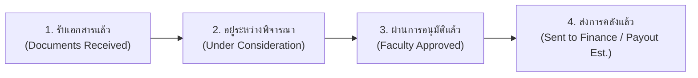

# เอกสารสถาปัตยกรรมและการออกแบบระบบ (System Architecture & SRS Document)
## ระบบจัดการเอกสารและการสะสมคะแนนกิจกรรมเพื่ออนุมัติทุนการศึกษา (ศูนย์จุฬาฯ-ชนบท)

---

### 1. บทนำและเป้าหมายของระบบ (System Overview & Objectives)
ระบบนี้ถูกออกแบบมาเพื่อยกระดับกระบวนการบริหารจัดการทุนการศึกษาของ **ศูนย์จุฬาฯ-ชนบท จุฬาลงกรณ์มหาวิทยาลัย** ให้เป็นระบบดิจิทัลแบบครบวงจร (End-to-End Digital Transformation) เพื่อแก้ปัญหาคอขวดในกระบวนการเดิม:
1. การตรวจสอบเอกสารกระดาษที่มีความล่าช้าและสูญหายง่าย
2. การคำนวณและติดตามชั่วโมงกิจกรรม/จิตอาสาสะสมที่ซับซ้อน โดยเจ้าหน้าที่ศูนย์ฯ เป็นผู้ตรวจสอบและกำหนดคะแนนสะสม
3. การส่งต่อข้อมูลเพื่อพิจารณาอนุมัติทุนระหว่างเจ้าหน้าที่ คณะกรรมการอาจารย์ และฝ่ายการคลัง
4. การจัดการฐานข้อมูลประวัติเก่าย้อนหลังกว่า 3,000 รายชื่อ (39 คอลัมน์)
5. การรองรับกรณีผู้สมัครใหม่ที่ยังไม่ได้รับรหัสนิสิต โดยสามารถใช้เลขประจำตัวประชาชน 13 หลัก เป็นรหัสอ้างอิงหลักในการติดต่อ ยื่นเอกสาร และติดตามสถานะ

---

### 2. กลุ่มผู้ใช้งานและสิทธิ์การเข้าถึง (User Roles & Permissions)

| กลุ่มผู้ใช้งาน (Role) | หน้าที่หลักและสิทธิ์การเข้าถึง |
| :--- | :--- |
| **หน้าแรกสาธารณะ (Public Portal)** | - **รายละเอียดศูนย์จุฬาฯ-ชนบท**: ประวัติความเป็นมา 40 ปี, วิสัยทัศน์, พันธกิจ, เสาหลัก 4 ด้าน, ช่องทางติดต่อศูนย์ฯ (จามจุรี 5, เบอร์โทร, อีเมลทางการ)<br>- **ผังโครงสร้างองค์กร (Organization Chart)**: แสดงผังผู้บริหาร ผู้อำนวยการ, รองผู้อำนวยการ, และ 4 ฝ่ายปฏิบัติการ (สวัสดิการทุน, ค่ายจิตอาสา, แนะแนว, การคลัง)<br>- **ศูนย์คำถามที่พบบ่อย (FAQ)**: 6 คำถามยอดนิยม ครอบคลุมคุณสมบัติ, **แนวปฏิบัติกรณีผู้สมัครใหม่ยังไม่มีรหัสนิสิตให้ใช้เลขบัตร ปชช.**, เกณฑ์ 40 แต้ม, GPAX, และบัญชี SCB<br>- **แกลเลอรีภาพกิจกรรมจิตอาสา**: ออกค่ายพัฒนาชนบท, ช่วยเหลือน้ำท่วม, โครงงานนวัตกรรมเพื่อชุมชน<br>- **ศูนย์ดาวน์โหลดเอกสารแบบฟอร์มทางการ (Download Center)**: แบบคำขอทุน, หนังสือรับรองรายได้, สมุดบันทึกชั่วโมงกิจกรรม, แบบสำรวจบ้าน<br>- **ข่าวสารประชาสัมพันธ์ & ปฏิทินรอบทุน**: วันตัดรอบรับเอกสาร (Cut-off)<br>- **ความปลอดภัย PDPA**: ไม่เปิดค้นหาสถานะทุนที่หน้าแรก ต้อง Login เข้าสู่ระบบก่อนเพื่อตรวจสอบข้อมูลส่วนบุคคล |
| **1. นิสิต (Student)** | - **รองรับทั้งนิสิตปัจจุบันและผู้สมัครใหม่**: กรณีที่ยังไม่ได้รับรหัสนิสิต สามารถใช้เลขประจำตัวประชาชน 13 หลัก ในการติดต่อ เข้าสู่ระบบ และยื่นเอกสารได้ทันที<br>- ดูและขอแก้ไขข้อมูลส่วนตัว 39 ฟิลด์ (มีแจ้งเตือนไปเจ้าหน้าที่และบันทึก Audit Log)<br>- ตรวจสอบสถานะทุนใน 4 ขั้นตอนแบบเรียลไทม์<br>- ดูแถบ Progress Bar เทียบเกณฑ์คะแนนขั้นต่ำ (เช่น 40 แต้ม)<br>- ส่งคำขอบันทึกชั่วโมงกิจกรรม พร้อมแนบภาพสแกนหลักฐาน<br>- อัปโหลดและตรวจสอบสถานะเอกสาร 7 แบบ<br>- ยินยอม Consent ข้อมูลอ่อนไหว/บัญชีธนาคาร (PDPA) |
| **2. อาจารย์ (Faculty / Approver)** | - ดู **Executive Dashboard**: สถิตินิสิต (ทั้งหมด 125, กำลังเรียน 97, จบ 17, พัก 3, พ้นสภาพ 6 คน, สัดส่วนกิจกรรม)<br>- **แผนที่ภูมิศาสตร์ Leaflet GIS Map**: แสดงพิกัดภูมิลำเนาผู้รับทุน (Lat, Lon) พร้อมตัวกรองค้นหา, กรองปี/รุ่น, กรองคณะ, กรองจังหวัด และ **Sort เรียงลำดับตามคะแนนกิจกรรมสะสม หรือ GPAX** พร้อมคลิกเล็งหมุดบนแผนที่<br>- ดูสรุปงบประมาณที่อนุมัติแล้วเทียบกับงบประมาณคงเหลือ (แท็บงบประมาณและการคลัง)<br>- พิจารณาอนุมัติทุนทีละรายบุคคล หรือ **อนุมัติพร้อมกันทั้งหมดในคลิกเดียว (1-Click Bulk Approval)**<br>- **หน้าต่างข้อมูลนิสิตฉบับเต็ม (Full Profile Modal)**: แสดงประวัติผลการเรียนแต่ละเทอม (GPA, GPAX, หน่วยกิตประจำภาค, หน่วยกิตสะสม), ประวัติการรับเงินทุนการศึกษา, ข้อมูลการติดต่อ, และบันทึกกิจกรรมจิตอาสา |
| **3. เจ้าหน้าที่ (Officer / Admin)** | - ตรวจสอบ To-do ประจำวัน (งานที่ต้องทำในวันนี้)<br>- จัดการ Content หน้าแรกสาธารณะผ่านระบบ CMS (ข่าวกิจกรรม, ข่าวประชาสัมพันธ์, เอกสารดาวน์โหลด, แบนเนอร์)<br>- ตารางคัดกรองเอกสารตามลำดับวันที่ส่ง รองรับการแสดงผลทั้งรหัสนิสิตและเลขประจำตัวประชาชน<br>- **หน้าต่าง Dual-View**: เทียบภาพสแกนกับเอกสารกระดาษจริง โดย **เจ้าหน้าที่เป็นผู้ประเมินและกำหนดคะแนนกิจกรรมสะสมโดยตรง**<br>- **ดูรายละเอียดนักศึกษาฉบับเต็มได้เหมือนส่วนของอาจารย์ (Student Profile & Academic Records Modal)**: ทั้งผลการเรียนรายภาค, ประวัติรับเงินทุน, ชั่วโมงกิจกรรม, ที่อยู่หอพัก, และจดหมายปรึกษาใจ<br>- **ปุ่มส่งต่อผู้อนุมัติ (Bulk Submit)** ให้คณะกรรมการอาจารย์<br>- **สวิตช์เปิด-ปิดรับสมัครทุนการศึกษา (Cut-off ON/OFF Switch)**: เลื่อนสวิตช์ควบคุมการเปิดรับสมัคร หรือปิดรับสมัครคำขอรับทุนและส่งเอกสารได้ทันที<br>- **ศูนย์แจ้งเตือนผ่าน Email ทางการ**: รองรับการเลือกกลุ่มเป้าหมายใน **Custom Group** (แยกเลือกชั้นปี, รุ่น, คณะ, ประเภททุน, สถานะ) และส่ง Email แจ้งเตือน<br>- **คิวตรวจสอบคำร้องแก้ Profile พร้อมส่ง Email ขอข้อมูลเพิ่ม (Email RFI)**<br>- **ระบบบันทึก Audit Logs (ประวัติการแก้ไขข้อมูล)**: จัดเก็บบันทึกประวัติในฐานข้อมูลตามมาตรฐาน PDPA (ไม่ต้องแสดงผลบน UI ให้ซับซ้อน) |

---

### 3. วงจรสถานะทุน 4 ขั้นตอน (4-Stage Scholarship Pipeline)



1. **รับเอกสารแล้ว (DOCUMENTS_RECEIVED)**: นิสิต/ผู้สมัครใหม่ยื่นคำขอและอัปโหลดไฟล์เข้าระบบ
2. **อยู่ระหว่างพิจารณา (UNDER_CONSIDERATION)**: เจ้าหน้าที่ตรวจสอบภาพสแกนเทียบกระดาษจริง กำหนดคะแนนกิจกรรมสะสมจนผ่านเกณฑ์ แล้วส่งต่อให้อาจารย์เป็นกลุ่ม (Bulk Submit)
3. **ผ่านการอนุมัติ (APPROVED)**: อาจารย์กดอนุมัติรายคน หรือกดอนุมัติทั้งรุ่นใน 1 คลิก พร้อมส่ง Email แจ้งผลไปยังนิสิต
4. **ส่งการคลังแล้ว คาดการณ์เวลาที่ได้รับเงิน (SENT_TO_FINANCE)**: เจ้าหน้าที่ส่งยอดให้ฝ่ายการคลัง พร้อมระบุวันที่คาดว่าเงินจะโอนเข้าบัญชี SCB ของนิสิต

---

### 4. แผนที่ภูมิศาสตร์ภูมิลำเนา Leaflet GIS Map

ระบบแผนที่บนแดชบอร์ดอาจารย์ พัฒนาด้วย **Leaflet.js** โดยอ้างอิงพิกัดละติจูดและลองจิจูด (`lat`, `lng`) ในฐานข้อมูลนิสิต:
- **ฟังก์ชันการกรอง (Filters):**
  - กรองด้วยคำค้นหา (Search: ชื่อ, รหัสนิสิต, เลขบัตรประชาชน, จังหวัด, โรงเรียน)
  - กรองตามรุ่น / ปีการศึกษา (Cohort: ทุกรุ่น, รุ่น 41, รุ่น 40, รุ่น 42 ผู้สมัครใหม่)
  - กรองตามคณะที่สังกัด (Faculty)
  - กรองตามจังหวัดภูมิลำเนา (Province)
- **ฟังก์ชันการจัดลำดับ (Sorting):**
  - เรียงตามคะแนนกิจกรรมสะสม (มาก ➔ น้อย / น้อย ➔ มาก)
  - เรียงตามเกรดเฉลี่ยสะสม GPAX (มาก ➔ น้อย / น้อย ➔ มาก)
- **การตอบสนองเชิงพื้นที่ (Spatial Interaction):**
  - หมุดสีชมพู (คะแนนผ่านเกณฑ์ $\ge 40$ แต้ม) และหมุดสีส้ม (คะแนนยังไม่ครบ $< 40$ แต้ม)
  - ตัวเลขบนหมุดแสดงแต้มกิจกรรมสะสมของนิสิตแต่ละคน
  - คลิกหมุดเพื่อเปิด Popup แสดงรูป, ชื่อ, คณะ, เลขบัตร ปชช., รหัสนิสิต, GPAX และคะแนน
  - คลิกรายชื่อในกล่องด้านข้าง แผนที่จะเลื่อนและซูม (Pan & Zoom) ไปยังพิกัดของนิสิตคนนั้นโดยอัตโนมัติ

---

### 5. การรองรับผู้สมัครใหม่ที่ยังไม่มีรหัสนิสิต (National Citizen ID Identification)
ในกรณีที่นิสิตเพิ่งผ่านการคัดเลือก หรือเพิ่งยืนยันสิทธิ์เข้าศึกษาและยังไม่ได้รับรหัสนิสิตทางการจากสำนักทะเบียน:
1. ระบบกำหนดให้ **เลขประจำตัวประชาชน 13 หลัก (Citizen ID)** เป็น Unique Primary Identifier ในการติดต่อ
2. การยื่นคำขอรับทุน, การอัปโหลดเอกสาร, และการบันทึกข้อมูลในฐานข้อมูล สามารถดำเนินการได้ทันทีโดยที่ช่อง `student_id` เป็นค่าว่าง (`NULL`)
3. ในทุกหน้าต่างแสดงผล (ตารางคัดกรอง, Dual-View, Modal, Leaflet Map) จะแสดงป้ายสถานะ `รอจัดสรรรหัสนิสิต (ผู้สมัครใหม่)` ควบคู่กับเลขบัตรประชาชน
4. เมื่อสำนักทะเบียนประกาศรหัสนิสิตทางการ เจ้าหน้าที่สามารถอัปเดตรหัสนิสิตเข้าสู่ระบบได้โดยไม่กระทบต่อประวัติเอกสารเดิม

---

### 6. โครงสร้างฐานข้อมูล Audit Log (Database Change Tracking & PDPA)

เพื่อปฏิบัติตาม พ.ร.บ. คุ้มครองข้อมูลส่วนบุคคล (PDPA) และมาตรฐาน Audit Trail ฐานข้อมูลมีตาราง `audit_logs` สำหรับติดตามทุกการแก้ไข:

```sql
CREATE TABLE audit_logs (
    id VARCHAR(50) PRIMARY KEY,
    timestamp TIMESTAMP DEFAULT CURRENT_TIMESTAMP,
    performed_by VARCHAR(150) NOT NULL,
    user_role VARCHAR(50) NOT NULL,            -- 'STUDENT', 'OFFICER', 'FACULTY', 'SYSTEM'
    citizen_id VARCHAR(20) NOT NULL,           -- เลขประจำตัวประชาชน 13 หลัก
    student_id VARCHAR(20),                    -- รหัสนิสิต (ถ้ามี)
    action_type VARCHAR(100) NOT NULL,         -- 'UPDATE_PROFILE', 'ASSIGN_ACTIVITY_SCORE', 'APPROVE_SCHOLARSHIP'
    field_name VARCHAR(100) NOT NULL,          -- เช่น 'bank_account_number', 'accumulatedScore'
    field_label VARCHAR(150) NOT NULL,         -- เช่น 'เลขที่บัญชีธนาคาร SCB'
    old_value TEXT,                            -- ค่าเดิมก่อนแก้ไข
    new_value TEXT,                            -- ค่าใหม่หลังแก้ไข
    ip_address VARCHAR(50),
    status VARCHAR(50) DEFAULT 'AUTO_LOGGED',  -- 'VERIFIED', 'PENDING', 'AUTO_LOGGED'
    verified_by VARCHAR(150),
    verified_at TIMESTAMP,
    note TEXT
);
```

---

### 7. เอกสารหลักฐานสำคัญ 7 แบบ (Standard Documents)
1. **แบบคำขอรับทุนการศึกษา (Application Form)**: พิมพ์จากระบบพร้อมลงนาม
2. **สำเนาบัตรประชาชน และ สำเนาทะเบียนบ้าน (ID & House Reg)**: รับรองสำเนาถูกต้อง
3. **ใบรายงานผลการศึกษา (Transcript CR60)**: ผลการเรียนเฉลี่ยสะสม (GPAX)
4. **สำเนาหน้าสมุดบัญชีธนาคารไทยพาณิชย์ (SCB Bank Book Copy)**: ผูกกับเลขบัตร ปชช. / รหัสนิสิต
5. **หนังสือรับรองรายได้ครอบครัว (Income Certification)**: ผู้นำชุมชน/ข้าราชการรับรอง
6. **บันทึกการปฏิบัติงานและชั่วโมงกิจกรรมสะสม (Activity Log)**: เจ้าหน้าที่ศูนย์ฯ ตรวจสอบและกำหนดแต้ม
7. **แบบรายงานสภาพความเป็นอยู่และภาพถ่ายบ้าน (Home Survey Photos)**: ภาพตัวบ้านและครอบครัว

---

### 8. สรุปการปรับปรุงระบบตามข้อกำหนดล่าสุด
1. **หน้าแรกสาธารณะ**: เพิ่มรายละเอียดประวัติและวิสัยทัศน์ของศูนย์ฯ, ผังโครงสร้างองค์กร (Organization Chart), และ FAQ 6 ข้อ
2. **การแจ้งเตือน**: ตัดระบบ Line OA ออกทั้งหมด โดยเปลี่ยนมาใช้ระบบ **Email แจ้งเตือนทางการ (@chula.ac.th หรืออีเมลผู้สมัคร)** และ In-App Alert
3. **การจัดการประเภททุน**: ตัดส่วนจัดการประเภททุน (แยกปี) ออกจากหน้าเจ้าหน้าที่ เพื่อความกระชับในการปฏิบัติงาน
4. **ผู้สมัครใหม่**: รองรับการติดต่อ ยื่นเอกสาร และติดตามสถานะด้วย **เลขประจำตัวประชาชน 13 หลัก** โดยไม่ต้องรอรหัสนิสิต
5. **หน้าเจ้าหน้าที่**: เพิ่มหน้าต่างดูประวัตินิสิตและผลการเรียนฉบับเต็ม (Student Profile & Academic Records) ครบถ้วนเหมือนของอาจารย์ พร้อมระบบที่ **เจ้าหน้าที่เป็นผู้กำหนดคะแนนกิจกรรมสะสมโดยตรง**
6. **แผนที่อาจารย์**: ใช้ **Leaflet.js** พร้อมพิกัด `lat`, `lng` มีตัวกรองค้นหา, กรองปี, คณะ, จังหวัด และ Sort เรียงตามคะแนนกิจกรรม
7. **Audit Trail**: จัดเก็บบันทึกประวัติการแก้ไขข้อมูลในฐานข้อมูล (Database-level Audit Trail) ตามมาตรฐาน PDPA โดยไม่ต้องแสดงผลบน UI ให้ซับซ้อน
8. **Cut-off Scheduler**: ตัดปฏิทินที่ซับซ้อนออก และเปลี่ยนเป็น **สวิตช์เปิด-ปิดรับสมัครทุน (ON/OFF Toggle Switch)** ให้เจ้าหน้าที่เลื่อนสลับสถานะเปิดหรือปิดรับสมัครได้ในคลิกเดียว
