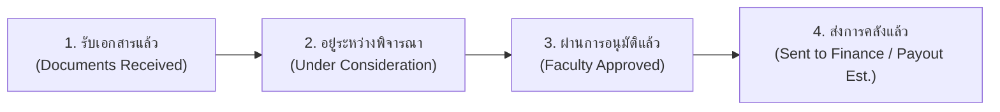

# เอกสารสถาปัตยกรรมและการออกแบบระบบ (System Architecture & SRS Document)
## ระบบจัดการเอกสารและการสะสมคะแนนกิจกรรมเพื่ออนุมัติทุนการศึกษา (ศูนย์จุฬาฯ-ชนบท)

---

### 1. บทนำและเป้าหมายของระบบ (System Overview & Objectives)
ระบบนี้ถูกออกแบบมาเพื่อยกระดับกระบวนการบริหารจัดการทุนการศึกษาของ **ศูนย์จุฬาฯ-ชนบท** ให้เป็นระบบดิจิทัลแบบครบวงจร (End-to-End Digital Transformation) โดยแก้ปัญหาคอขวดในกระบวนการเดิม:
1. การตรวจสอบเอกสารกระดาษที่มีความล่าช้าและสูญหายง่าย
2. การคำนวณและติดตามชั่วโมงกิจกรรม/จิตอาสาสะสมที่ซับซ้อน
3. การส่งต่อข้อมูลเพื่อพิจารณาอนุมัติทุนระหว่างเจ้าหน้าที่ คณะกรรมการอาจารย์ และฝ่ายการคลัง
4. การจัดการฐานข้อมูลประวัติเก่าย้อนหลังกว่า 3,000 รายชื่อ (39 คอลัมน์)

---

### 2. กลุ่มผู้ใช้งานและสิทธิ์การเข้าถึง (User Roles & Permissions)

| กลุ่มผู้ใช้งาน (Role) | หน้าที่หลักและสิทธิ์การเข้าถึง |
| :--- | :--- |
| **หน้าแรกสาธารณะ (Public Portal)** | - **แกลเลอรีภาพกิจกรรมจิตอาสา**: ออกค่ายพัฒนาชนบท, ช่วยเหลือน้ำท่วม, โครงงานนวัตกรรมเพื่อชุมชน - **ศูนย์ดาวน์โหลดเอกสารแบบฟอร์มทางการ (Download Center)**: แบบคำขอทุน, หนังสือรับรองรายได้, สมุดบันทึกชั่วโมงกิจกรรม, แบบสำรวจบ้าน - **ข่าวสารประชาสัมพันธ์ & ปฏิทินรอบทุน**: วันตัดรอบรับเอกสาร (Cut-off) - **ความปลอดภัย PDPA**: ไม่เปิดค้นหาสถานะทุนที่หน้าแรก นิสิตต้อง Login เข้าสู่ระบบก่อนเพื่อตรวจสอบข้อมูลส่วนบุคคล |
| **1. นิสิต (Student)** | - ดูและขอแก้ไขข้อมูลส่วนตัว 39 ฟิลด์ (มีแจ้งเตือนไปเจ้าหน้าที่และบันทึก Audit Log) - ตรวจสอบสถานะทุนใน 4 ขั้นตอนแบบเรียลไทม์ - ดูแถบ Progress Bar เทียบเกณฑ์คะแนนขั้นต่ำ (เช่น 40 แต้ม) - ส่งคำขอบันทึกชั่วโมงกิจกรรม พร้อมแนบภาพสแกนหลักฐาน - อัปโหลดและตรวจสอบสถานะเอกสาร 7 แบบ - ยินยอม Consent ข้อมูลอ่อนไหว/บัญชีธนาคาร (PDPA) |
| **2. อาจารย์ (Faculty / Approver)** | - ดู **Executive Dashboard** (สถิตินิสิตทั้งหมด 125 คน, กำลังเรียน 97, จบ 17, พัก 3, พ้นสภาพ 6 คน, สัดส่วนกิจกรรม, ภูมิศาสตร์จังหวัด) - ดูสรุปงบประมาณที่อนุมัติแล้วเทียบกับงบประมาณคงเหลือ (แท็บงบประมาณและการคลัง) - พิจารณาอนุมัติทุนทีละรายบุคคล หรือ **อนุมัติพร้อมกันทั้งหมดในคลิกเดียว (1-Click Bulk Approval)** - **หน้าต่างข้อมูลนิสิต**: แสดงประวัติผลการเรียนแต่ละเทอม (GPA, GPAX, หน่วยกิตประจำภาค, หน่วยกิตสะสม), ประวัติการรับเงินทุนการศึกษา, ข้อมูลการติดต่อ, และบันทึกกิจกรรมจิตอาสา |
| **3. เจ้าหน้าที่ (Officer / Admin)** | - ตรวจสอบ To-do ประจำวัน (งานที่ต้องทำในวันนี้) - จัดการ Content หน้าแรกสาธารณะผ่านระบบ CMS (ข่าวกิจกรรม, ข่าวประชาสัมพันธ์, เอกสารดาวน์โหลด, แบนเนอร์) - ตารางคัดกรองเอกสารตามลำดับวันที่ส่ง - **หน้าต่าง Dual-View**: เทียบภาพสแกนกับเอกสารกระดาษจริง พร้อมช่องบันทึกคะแนนและกดรับรอง - **ปุ่มส่งต่อผู้อนุมัติ (Bulk Submit)** ให้คณะกรรมการอาจารย์ - **จัดการข้อมูลทุนทุกแบบ**: แก้ไขเกณฑ์ GPAX, โควตาคน, งบประมาณจัดสรร, และสถานะเปิด/ปิดรับคำขอ แยกปีการศึกษาโดยไม่ทับประวัติเก่า - **ปฏิทิน & ตัดรอบ Cut-off**: ตั้งเวลาด้วยตัวเลือกวันที่และเวลาจริง (HTML5 Date & Time Picker) - **ศูนย์แจ้งเตือนแบบเจาะจง**: รองรับการเลือกกลุ่มเป้าหมายใน **Custom Group** (แยกเลือกชั้นปี, รุ่น, คณะ, ประเภททุน, สถานะ) - **คิวตรวจสอบคำร้องแก้ Profile พร้อมฟอร์มส่ง Line OA**: กดขอข้อมูลเพิ่มเพื่อเปิดฟอร์มระบุสาเหตุและยิงแจ้งเตือนตรงเข้า Line OA ของนิสิต |

---

### 3. วงจรสถานะทุน 4 ขั้นตอน (4-Stage Scholarship Pipeline)

1. **รับเอกสารแล้ว (DOCUMENTS_RECEIVED)**: นิสิตยื่นคำขอและอัปโหลดไฟล์เข้าระบบ
2. **อยู่ระหว่างพิจารณา (UNDER_CONSIDERATION)**: เจ้าหน้าที่ตรวจสอบภาพสแกนเทียบกระดาษจริงและรับรองคะแนนสะสมผ่านเกณฑ์ แล้วส่งต่อให้อาจารย์เป็นกลุ่ม (Bulk Submit)
3. **ผ่านการอนุมัติ (APPROVED)**: อาจารย์กดอนุมัติรายคน หรือกดอนุมัติทั้งรุ่นใน 1 คลิก
4. **ส่งการคลังแล้ว คาดการณ์เวลาที่ได้รับเงิน (SENT_TO_FINANCE)**: เจ้าหน้าที่ส่งยอดให้ฝ่ายการคลัง พร้อมระบุวันที่คาดว่าเงินจะโอนเข้าบัญชี SCB ของนิสิต

---

### 4. เอกสารหลักฐานสำคัญ 7 แบบ (Standard Documents)
1. **แบบคำขอรับทุนการศึกษา (Application Form)**: พิมพ์จากระบบพร้อมลงนาม
2. **สำเนาบัตรประชาชน และ สำเนาทะเบียนบ้าน (ID & House Reg)**: รับรองสำเนาถูกต้อง
3. **ใบรายงานผลการศึกษา (Transcript CR60)**: ผลการเรียนเฉลี่ยสะสม (GPAX)
4. **สำเนาหน้าสมุดบัญชีธนาคารไทยพาณิชย์ (SCB Bank Book Copy)**: ผูกกับรหัสนิสิต (ฟิลด์ที่ 38)
5. **หนังสือรับรองรายได้ครอบครัว (Income Certification)**: ผู้นำชุมชน/ข้าราชการรับรอง
6. **บันทึกการปฏิบัติงานและชั่วโมงกิจกรรมสะสม (Activity Log)**: แสดงแต้มกิจกรรมครบเกณฑ์
7. **แบบรายงานสภาพความเป็นอยู่และภาพถ่ายบ้าน (Home Survey Photos)**: ภาพตัวบ้านและครอบครัว

---

### 5. การรองรับฐานข้อมูลเดิม Excel 39 คอลัมน์ (~3,000 Users)

| ลำดับ | ชื่อคอลัมน์ในฐานข้อมูลเดิม | ประเภทข้อมูลใน PostgreSQL | คำอธิบายและความเชื่อมโยง |
| :--- | :--- | :--- | :--- |
| 1 | ลำดับที่ | `INT` | เลขลำดับภาพรวมของโครงการ |
| 2 | ลำดับในรุ่น | `INT` | ลำดับของนิสิตในรุ่นที่รับเข้า |
| 3 | ลำดับคณะ | `INT` | ลำดับของนิสิตในคณะนั้นๆ |
| 4 | รุ่นที่ | `VARCHAR(50)` | เช่น "2566 (รุ่น 41)", "2565 (รุ่น 40)" |
| 5 | รหัสประจำตัวประชาชน | `VARCHAR(20) UNIQUE` | ใช้ในการยืนยันตัวตนและตรวจสอบสิทธิ์ |
| 6 | รหัสนิสิต | `VARCHAR(20) UNIQUE` | รหัสนิสิตจุฬาฯ 8 หลัก (Indexed) |
| 7-9 | คำนำหน้า, ชื่อ, นามสกุล | `VARCHAR(100)` | ชื่อภาษาไทย |
| 10-11 | ชื่อ-สกุล ภาษาอังกฤษ | `VARCHAR(100)` | สำหรับหนังสือรับรองและการคลัง |
| 12-13 | คณะ, สาขาวิชา | `VARCHAR(150)` | สังกัดการศึกษา |
| 14-16 | โรงเรียนที่จบ, อำเภอ, จังหวัด | `VARCHAR(150)` | ประวัติภูมิลำเนาเดิม |
| 17-19 | ชื่อบิดา, มารดา, สถานภาพครอบครัว | `VARCHAR(150)` | อยู่ด้วยกัน/หย่าร้าง/ถึงแก่กรรม |
| 20-23 | ผู้ปกครอง, อาชีพผู้ปกครอง/บิดา/มารดา | `VARCHAR(150)` | ข้อมูลอาชีพครอบครัว |
| 24 | รายได้ต่อเดือนบิดา/มารดา/ผู้ปกครอง | `NUMERIC(12,2)` | เกณฑ์ความจำเป็นทางเศรษฐกิจ |
| 25-29 | ที่อยู่, ตำบล, อำเภอ, จังหวัด, รหัสไปรษณีย์ | `TEXT` / `VARCHAR` | ที่อยู่ภูมิลำเนาสำหรับเยี่ยมบ้าน |
| 30-32 | เบอร์โทรศัพท์, เบอร์ฉุกเฉิน, ความสัมพันธ์ | `VARCHAR(50)` | การติดต่อสื่อสารเร่งด่วน |
| 33-37 | ชื่อบัญชี, เลขที่บัญชี, ธนาคาร, สาขา, รหัสสาขา | `VARCHAR(100)` | บัญชีรับเงินโอนค่าใช้จ่ายทุน |
| 38 | ไฟล์สำเนาหน้าสมุดบัญชีที่ใช้ผูกกับรหัสนิสิต | `TEXT (URL)` | หลักฐานภาพถ่ายสมุดบัญชี |
| 39 | หมายเหตุ | `TEXT` | บันทึกประวัติเฉพาะรายบุคคล |

---

### 6. ระบบรักษาความปลอดภัยและความเป็นส่วนตัว (PDPA & Audit Logs)
1. **Consent Management**: บังคับให้ยินยอมเปิดเผยข้อมูลส่วนบุคคลและข้อมูลอ่อนไหวก่อนส่งคำขอ
2. **Profile Change Verification & Audit Log**: หากนิสิตแก้ไขข้อมูลสำคัญ (เช่น เลขบัญชี, เบอร์ฉุกเฉิน, ที่อยู่) ระบบจะบันทึกสถานะเป็น Pending รอเจ้าหน้าที่กด Verify และจัดเก็บ `old_value`, `new_value`, วันเวลา และ IP Address ลงตาราง Audit Log ทุกครั้ง
3. **Dual-View Scanned vs Paper Checklist**: ป้องกันการปลอมแปลงเอกสารโดยการเปรียบเทียบภาพสแกนกับเอกสารกระดาษฉบับจริงพร้อมลายเซ็นก่อนให้คะแนน
